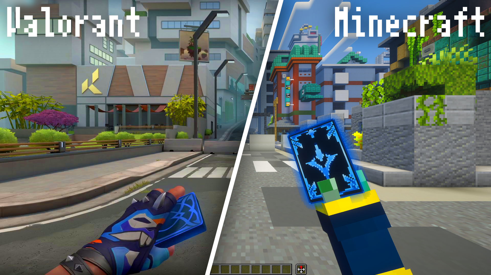

# 에리스 카드 (Aeris Card)
이 모드는 발로란트의 '**에리스 플렉스**'를 마인크래프트로 구현한 모드입니다.

라이엇 게임즈의 허가를 받지 않은 **비공식 모드**이며, 라이엇 게임즈는 이 프로젝트를 지지하거나 후원하지 않습니다.
모델과 도트는 직접 제작했고, 라이엇의 이미지와 소리 파일은 사용하지 않았습니다.

라이엇의 요청에 의해 이 모드가 **삭제**될 수 있습니다. 「[라이엇 지식재산 이용 정책](https://www.riotgames.com/ko/legal)」

---

## 원작과 비교한 이미지

(왼쪽 이미지는 [Axiom 모드](https://modrinth.com/mod/axiom)를 사용한 상태입니다)

## 구현한 기능
| 기능 | 설명 |
|:--:|--|
| 스왑 | 에리스 카드를 들었을 때 보이는 애니메이션 재생 |
| 좌클릭 | 에리스 카드를 든 상태에서 좌클릭을 할 시 좌클릭 애니메이션 재생 및 블록 파괴와 공격 비활성화  |
| 카드 자세히 보기 | '카드 자세히 보기'(기본설정은 Y키)를 눌러 카드 자세히보기 애니메이션 재생 |
| 이스터에그 | 원작의 이스터에그를 다른 무늬로 구현 |
| 기타 | 더 많은 기능은 [이 영상](https://youtube.com/shorts/20s58enfobI)을 참고주길 바랍니다 |

## 요구사항
- Minecraft 26.2
- Fabric Loader, Fabric API
- GeckoLib 5

---
## 설치방법 및 아이템 지급
아래에서 `aeriscard-1.0.0.jar`파일을 다운로드해줍니다

다운로드 한 후 `mods`폴더에 `aeriscard-1.0.0.jar`파일을 넣고 패브릭 마인크래프트를 실행시켜줍니다

`/give @s aeriscard:aeriscard`를 입력하여 에리스 카드를 지급받을 수 있습니다
---
## 다운로드
[최신 버전 다운로드](https://github.com/Creepeong/AerisCard/releases/latest)